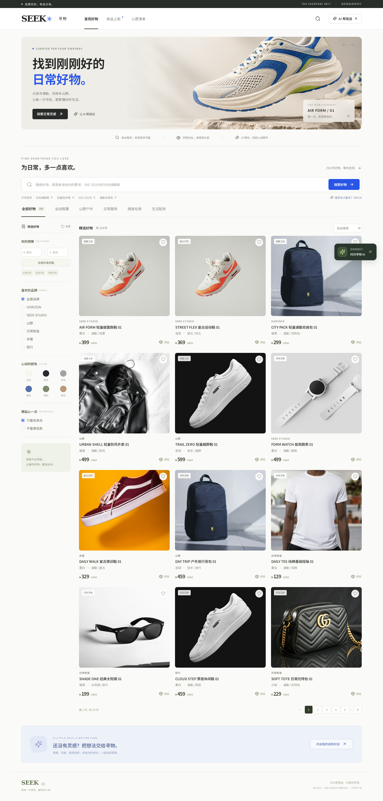

# SEEK 寻物 · 电商智能搜索与导购

用 Python 实现的电商搜索与 AI 导购项目。包含商品导入、关键词与向量混合检索、可选模型精排、商品系列重排、多轮导购、收藏和商品对比。

后端使用 FastAPI、SQLite 和 OpenSearch，前端使用 React、TypeScript、Vite、Tailwind CSS 与 Radix/shadcn 风格组件。界面自带中文字体，图片保存在本地，浏览时不依赖外部图床。

> 当前商品、价格、库存和规格均为模拟数据，图片仅作风格示意，不提供下单和付款。



[手机界面](docs/screenshots/mobile.png) · [真实导购会话截图](docs/screenshots/assistant.png) · [完整验证记录](docs/validation.md)

## 在当前机器启动

项目已有虚拟环境、模型缓存、商品索引和前端构建产物，可以直接运行：

```bash
cd /home/dudu/project/电商智能搜索
.venv/bin/python scripts/start.py
```

启动后访问 **http://127.0.0.1:8000**；接口文档是 **http://127.0.0.1:8000/docs**。

脚本会在需要时启动项目内的 OpenSearch，并提供构建后的前端页面。保持终端打开，按 `Ctrl+C` 关闭这次启动的服务。已有的外部 OpenSearch 不会由脚本关闭。

## 在新环境安装

验证环境为 Linux x64、Python 3.12、Node.js 24。所有命令从项目根目录执行，前端命令除外。

```bash
uv venv --python 3.12
uv pip install --torch-backend=cpu --python .venv/bin/python -r requirements.lock.txt
```

已有 `.venv` 时跳过创建。`requirements.txt` 声明直接依赖，`requirements.lock.txt` 锁定本次验证的完整环境；CPU 参数避免下载 CUDA 依赖。

```bash
cd frontend
npm ci
npm run build
cd ..
```

仅全新克隆且没有 `.env` 时，从 `.env.example` 创建自己的配置。已有配置不需要覆盖。主要字段如下：

```dotenv
OPENAI_API_KEY=你的服务密钥
OPENAI_BASE_URL=你的模型服务基础地址
CHAT_MODEL=服务支持的聊天模型名称
```

`CHAT_MODEL` 留空时，程序通过 `/models` 查询，优先选择可用的轻量聊天模型，并把选择记录在 `runtime/chat_model.json`。服务需要支持 `/chat/completions` 和 function calling；如果不能列出模型，应手动填写 `CHAT_MODEL`。密钥只由后端读取，前端没有密钥配置。

下载本地模型并建立索引：

```bash
.venv/bin/python scripts/download_models.py
.venv/bin/python scripts/start_search.py
```

保持搜索引擎终端打开，在另一终端导入商品：

```bash
.venv/bin/python scripts/import_products.py
```

导入后，可以停止单独启动的搜索引擎，再用 `scripts/start.py` 统一启动。Linux 本地发行包首次下载约 1 GB，带有自己的 JDK，不要求编写 Java 或安装系统 Java。本地模型也需要首次下载，之后只从本地缓存加载。

已有 Docker 时，也可以使用 `docker compose up -d` 运行 OpenSearch。两种方式选一种即可。这里的无密码搜索节点只绑定本机回环地址。

## 开发前端

开发时分三个终端运行：

```bash
# 终端一：搜索引擎
.venv/bin/python scripts/start_search.py

# 终端二：Python 接口
.venv/bin/python -m uvicorn app:app --app-dir backend --host 127.0.0.1 --port 8000

# 终端三：前端开发服务器
cd frontend
npm run dev
```

前端访问 **http://127.0.0.1:5173**，Vite 将 `/api` 和 `/images` 转发给后端。开发端口固定代理到 8000；修改后端端口时，相应修改 `frontend/vite.config.ts`。生产构建通过相对 API 地址工作。

## 先体验这些功能

1. 搜索“500元以内的白色通勤运动鞋”，检查预算和颜色是否生效。
2. 继续增加“不要厚底”，确认排除条件生效。
3. 使用品牌、颜色、价格、库存筛选，并尝试价格排序与分页。
4. 收藏商品，在心愿清单中查看；收藏保存于当前浏览器。
5. 选择两到三件商品，打开对比表；表格直接读取数据库属性。
6. 打开 AI 导购，分三轮输入“500元以内的白色通勤运动鞋”“不要厚底的”“比较一下前两双”。

导购会话保存在 SQLite，浏览器只保存会话 ID。右上角加号开始新对话并删除旧会话。界面不会显示内部思考过程。

## 搜索链路与取舍

```text
商品 JSONL → 字段校验、去重 → SQLite → 商品向量 → OpenSearch 新索引 → 别名切换

查询 → 提取显式条件 → SQL 硬过滤 → BM25 / 向量召回 → RRF 名次融合
                                                ↓
                                    可选 Cross-Encoder 精排
                                                ↓
                                    可选商品系列多样性调整
```

价格、颜色、库存和排除条件先过滤，最终商品记录也从 SQLite 获取。检索结果不能重新引入不符合条件或不存在的商品。

默认使用 **hybrid 混合检索**。本次模拟数据回归中，它的相关性高于当前未针对商品训练的精排模型，且耗时更低。精排和多样性重排作为可独立评测的能力保留，不默认开启。具体数据见 [评测报告](docs/evaluation.md)。

`POST /api/search` 的 `mode` 可以指定：

| 模式 | 行为 |
| --- | --- |
| `keyword` | 仅关键词召回 |
| `hybrid` | 关键词与向量召回，RRF 融合，默认模式 |
| `rerank` | 混合检索后，对前 32 个候选做模型精排 |
| `diverse` | 精排后，在前 12 个候选内调整系列顺序 |

不将不同量纲的原始分数直接相加。商品向量使用归一化余弦相似度，模型默认在 CPU 上运行，推理线程数为 4。

OpenSearch 不可用时，自动降级到 SQLite FTS5 与本地 NumPy 向量检索；本地模型不可用时保留关键词能力，并返回降级提示。搜索模型不会在一次用户请求中自动下载。

## Agent 如何工作

`backend/agent.py` 直接实现有限轮次的工具调用，没有额外的 Agent 框架：

```text
用户消息 → 更新会话约束 → 模型选择工具 → 校验参数 → 执行工具
                                                 ↓
                            商品卡片 / 对比表 + 模型简短说明
```

工具包括 `search_products`、`get_product_detail`、`check_stock`、`compare_products`。最多 3 轮模型请求、6 次工具调用，并限制同时进行的模型会话数量。

预算、颜色等已记录条件不会因为模型遗漏参数而消失。用户明确取消限制时也会记录取消状态，防止模型从历史消息中重新引入旧条件。比较工具只接受最近候选列表中的商品 ID。

模型超时、服务报错、没有执行有效商品工具等情况，会明确进入降级流程，用真实数据库记录返回搜索或对比结果。模型生成的文字仍可能有误，页面上的价格、库存和比较表由后端数据直接生成。

## 数据与导入

内置 **256 条模拟商品**，覆盖 32 个系列，以及 **30 条规则标注的搜索回归查询**。它们用于功能演示和回归，不能证明真实业务上的推荐收益、点击率或搜索质量。

重新生成演示数据与本地图片：

```bash
.venv/bin/python scripts/create_demo.py
.venv/bin/python scripts/import_products.py
```

导入自己的 JSONL：

```bash
.venv/bin/python scripts/import_products.py --file data/raw/my-products.jsonl
```

每行至少提供 `id`、`name`、`brand`、`category`、`color`、`price`、`stock`、`tags`。字段示例见 `data/products.jsonl`。同 ID 保留文件中最后一条记录；先校验完整文件，再替换数据库快照。更新数据后重启后端，以刷新内存中的模型和向量快照。

素材来源、生成主视觉和提示词见 [素材说明](docs/assets.md)。

## 验证与评测

后端测试使用临时数据库和模拟 HTTP 响应，不消耗模型 API 额度：

```bash
.venv/bin/python -m pytest
```

浏览器测试需要先启动开发服务器或完整应用：

```bash
cd frontend
PLAYWRIGHT_BROWSERS_PATH=../runtime/browsers npm exec playwright install chromium
npm test
# 测试构建后的完整应用时：
APP_URL=http://127.0.0.1:8000 npm test
```

覆盖桌面、手机、中文字体、横向溢出、搜索硬条件、收藏持久化、商品对比和对话会话。浏览器导购测试拦截模型回复，真实模型联通另行验证。

```bash
.venv/bin/python scripts/evaluate.py
```

报告写入 `docs/evaluation.md`，逐查询结果写入 `runtime/evaluation.json`。NDCG@10、Recall@20 和串行调用耗时分开记录，不把离线回归当作线上并发压测。

## 阅读代码

建议依次阅读：`app.py` → `schemas.py` → `database.py` → `text.py` → `search.py` → `ranking.py` → `agent.py`。`search_engine.py` 单独放 OpenSearch 接口，`import_data.py` 负责数据校验和导入。

业务代码使用普通函数和明确名称，不定义双下划线魔术方法。前端组件按搜索、筛选、商品、对比、导购拆分。

## Git 与本地文件

`.gitignore` 忽略 `.env`、虚拟环境、模型缓存、OpenSearch 发行包、运行数据库、日志、原始数据下载、`node_modules`、构建产物和测试临时文件。

可以提交源码、演示数据、查询标注、依赖锁文件、文档和截图。`.env.example` 没有真实密钥。项目不会自行创建 GitHub 仓库、提交或推送。

